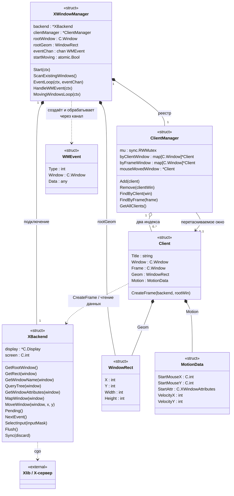

# GopherWM

Экспериментальный оконный менеджер для X11, написанный на Go. GopherWM взаимодействует с X-сервером через Xlib и cgo, добавляет к окнам боковую панель с названием и позволяет перемещать их мышью.

Особенность проекта — режим автоматического движения: окна перемещаются по экрану и отскакивают от его границ. Перетаскивание мышью меняет скорость дальнейшего движения окна.

## Возможности

- Подхват уже открытых окон при запуске.
- Создание рамок с синей боковой панелью и вертикальным отображением названия.
- Перемещение окон за боковую панель.
- Обработка запросов приложений на отображение и изменение геометрии, событий скрытия и уничтожения окон.
- Запуск терминала и переключение анимации горячими клавишами.
- Тестовый запуск во вложенном X-сервере Xephyr.

Проект находится на стадии прототипа. Настройки оформления и сочетания клавиш заданы в исходном коде.

## Требования

- Linux с графической сессией, в которой доступен X11.
- Go версии, указанной в `go.mod` (сейчас `1.27.1`), или новее.
- Компилятор C, заголовочные файлы и библиотека Xlib; поддержка cgo должна быть включена.
- Для тестовой сессии: `Xephyr`, `xinit`, `xterm`, `xclock` и `xeyes`.
- Опционально: Task для команд из `taskfile.yml`.

Системные зависимости для Debian / Ubuntu:

```sh
sudo apt install build-essential libx11-dev xserver-xephyr xinit xterm x11-apps
```

Go и Task устанавливаются отдельно.

## Сборка и запуск

Выполните из корня проекта:

```sh
go build -o bin/gopherwm .
./start.sh
```

Скрипт запускает Xephyr на дисплее `:2` с разрешением `1024×768`. Через `xinitrc` открываются `xclock`, `xeyes` и `xterm`, после чего запускается GopherWM. Дисплей `:2` должен быть свободен.

При установленном Task сборку и запуск можно выполнить одной командой:

```sh
task
```

Для запуска в отдельно подготовленной X-сессии используйте:

```sh
./bin/gopherwm
```

В этом случае переменная `DISPLAY` должна указывать на нужный X-сервер, а другой оконный менеджер в этой сессии не должен быть запущен.

## Управление

| Действие | Управление |
| --- | --- |
| Открыть терминал `xterm` | `Super + Enter` |
| Включить или выключить автоматическое движение окон | `Super + M` |
| Переместить окно | Перетащить его за левую боковую панель |

`Super` соответствует модификатору `Mod4`, обычно это клавиша Windows. Автоматическое движение по умолчанию выключено.

## Команды разработки

| Команда | Назначение |
| --- | --- |
| `task` | Собрать проект и запустить тестовую сессию |
| `task build` | Отформатировать код и собрать `bin/gopherwm` |
| `task fmt` | Выполнить `go fmt ./...` |
| `task test` | Выполнить `go test -v ./...` |
| `task clean` | Удалить каталог `bin/` |

## Устройство проекта

```text
main.go          Точка входа, обработка SIGINT и SIGTERM
xwindowmgr/      Работа с X11 и управление окнами
start.sh         Запуск вложенного X-сервера Xephyr
xinitrc          Приложения тестовой сессии и запуск менеджера
taskfile.yml     Команды сборки и разработки
```

### Основные типы и связи

В Go вместо классов используются структуры с методами. На схеме Mermaid ниже показаны основные структуры пакета `xwindowmgr`, их данные и ключевые методы. Список полей и методов сокращён, чтобы выделить связи между компонентами.



**`XWindowManager` — координатор работы.** Конструктор `NewXWindowManager()` создаёт подключение `XBackend`, реестр `ClientManager` и буферизированный канал на 200 событий. Менеджер хранит дескриптор корневого окна и его геометрию, регистрирует горячие клавиши, находит существующие окна и запускает три рабочих цикла. Его методы распределены между файлами `xwm.go`, `xwmhandlers.go`, `xwmshortcuts.go`, `xwmeventloop.go`, `xwmwmeventhandle.go` и `xwmmoving.go`.

**`XBackend` — подключение к X11.** Хранит указатель `Display` и номер экрана. При создании инициализирует многопоточную работу Xlib, открывает дисплей и устанавливает обработчик ошибок. Предоставляет операции получения корневого окна и геометрии, выбора событий, синхронизации и отправки накопленных запросов. Все вызовы функций Xlib сосредоточены в `XBackend`: остальные компоненты используют его методы для работы с окнами, чтения событий, регистрации горячих клавиш, захвата указателя и отрисовки. Backend также преобразует строки и копирует список дочерних окон в память Go, освобождая выделенную Xlib память. Типы и константы C пока используются и в остальных файлах пакета.

**`ClientManager` — реестр управляемых окон.** Две карты позволяют найти один и тот же `Client` по дескриптору окна приложения (`Window`) или внешней рамки (`Frame`). Это нужно, поскольку события X11 могут относиться к любому из этих окон. Реестр также хранит ссылку на окно, которое пользователь сейчас перетаскивает, и выдаёт список клиентов для анимации. `sync.RWMutex` защищает карты и доступ к этой ссылке; поля самих объектов `Client` этим мьютексом не защищаются.

**`Client` — состояние одного окна приложения.** Содержит название, два дескриптора X11, геометрию и параметры движения. Функция `generateClientContext()` считывает геометрию и название окна и задаёт начальную случайную скорость. Метод `CreateFrame()` создаёт внешнее окно-рамку и помещает внутрь него окно приложения со смещением вправо на ширину боковой панели. Поэтому `Frame` — вся внешняя рамка, а не только полоса с названием. Отрисовкой панели и обработкой событий занимается `XWindowManager`.

**`WindowRect` и `MotionData` — структуры состояния.** Первая хранит координаты и размеры; используется и для корневого окна, и для клиентов. Вторая содержит начальные координаты указателя и атрибуты рамки при перетаскивании, а также скорость автоматического движения по двум осям. Эти данные встроены в `Client` как значения.

**`WMEvent` — сообщение между циклами чтения и обработки событий.** Поле `Type` определяет вид события X11, `Window` указывает его окно, а `Data` содержит копию соответствующей структуры Xlib. Метод `parseXEvent()` формирует сообщение, а `handleWMEvent()` выбирает обработчик и проверяет тип данных.

### Как компоненты взаимодействуют

При запуске `main.go` создаёт контекст с отменой по `SIGINT` и `SIGTERM`, конструирует менеджер и вызывает `Start(ctx)`. Перед запуском горутин менеджер регистрирует сочетания клавиш, подписывается на события корневого окна и выполняет `ScanExistingWindows()`. Для каждого подходящего видимого окна создаются `Client` и рамка, после чего клиент добавляется в реестр.

После инициализации работают три цикла. Это методы одного `XWindowManager`, а не отдельные классы:

| Цикл | Задача | Взаимодействие |
| --- | --- | --- |
| `EventLoop` | Читать очередь X11 | Получает `XEvent`, преобразует его через `parseXEvent()` и отправляет `WMEvent` в `eventChan` |
| `HandleWMEvent` | Обрабатывать события | Читает канал, вызывает обработчик, обращается к реестру и выполняет операции Xlib |
| `MovingWindowsLoop` | Анимировать окна | Примерно раз в 20 мс проверяет `startMoving`, получает клиентов из реестра и перемещает их рамки |

Например, при открытии приложения путь события выглядит так: X11 → `EventLoop` → `WMEvent` в канале → `HandleWMEvent` → `handleMapRequest()`. Если клиент ещё не зарегистрирован, обработчик создаёт его состояние, вызывает `Client.CreateFrame()`, добавляет объект в `ClientManager` и отображает рамку вместе с окном приложения. При уничтожении окна `handleDestroyNotify()` уничтожает рамку и удаляет клиента из обоих индексов.

При нажатии на боковую панель обработчик находит клиента по `Frame`, запоминает начальные координаты и регистрирует его как перетаскиваемого. События движения указателя меняют положение рамки и скорость в `MotionData`; отпускание кнопки завершает перетаскивание. Цикл анимации пропускает перетаскиваемое окно, а для остальных обновляет координаты и меняет знак скорости при выходе за границы экрана. Сочетание `Super + M` переключает атомарный флаг `startMoving`.

Вспомогательный файл `xwindowutils.go` содержит преобразования событий Xlib и запуск внешних процессов, а `x11gohelper.hpp` — функции C для работы с макросами Xlib, получения названия окна и обработки ошибок.
